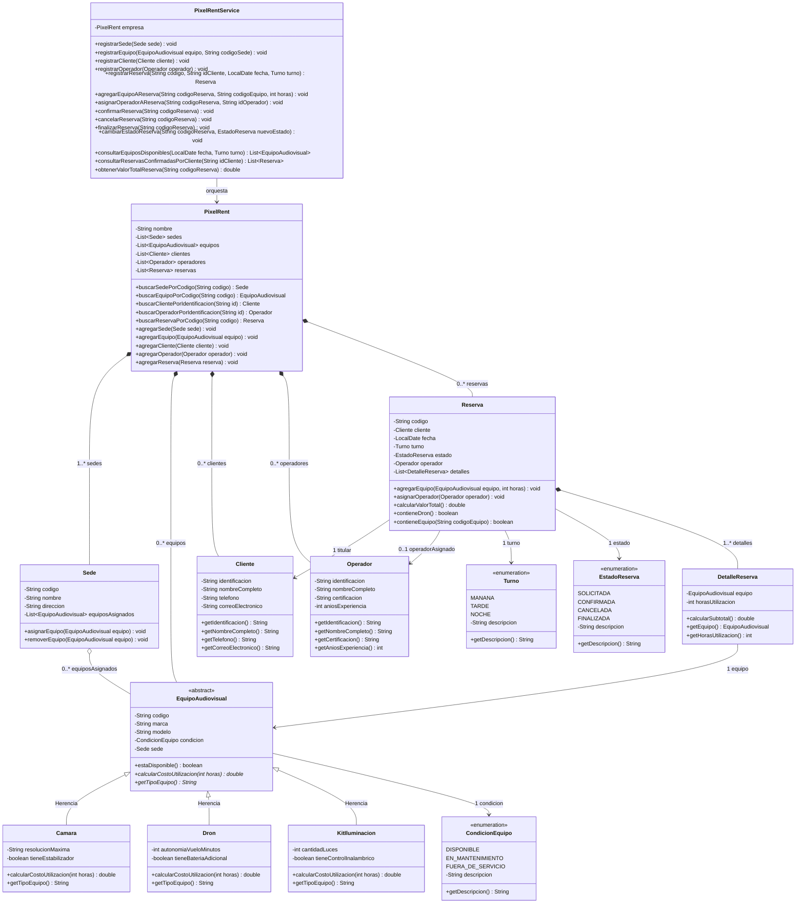

# Sistema de Gestión de Alquiler de Equipos Audiovisuales - PixelRent

**Asignatura:** Programación I  
**Institución:** Universidad del Quindío  
**Proyecto:** PixelRent - Gestión de Alquiler Audiovisual  

---

## 1. Desarrollo del Pensamiento Computacional (0.5 pts)

### Abstracción
* **¿Qué se solicita finalmente? (problema):**  
  Desarrollar un sistema de información orientado a objetos para la empresa **PixelRent**, que permita administrar de forma consistente y centralizada el alquiler de equipos audiovisuales (cámaras, drones y kits de iluminación) distribuidos en sedes, gestionando clientes, operadores técnicos y el ciclo de vida de las reservas (solicitada, confirmada, cancelada, finalizada), garantizando la no duplicidad de códigos, la prevención de colisiones en fechas/turnos, la asignación obligatoria de operadores para drones y el cálculo preciso de costos.

* **¿Qué información es relevante dado el problema anterior?:**  
  * **Sedes:** código, nombre, dirección y equipos asignados.
  * **Equipos Audiovisuales:** código único, marca, modelo, condición operativa (`DISPONIBLE`, `EN_MANTENIMIENTO`, `FUERA_DE_SERVICIO`).
    * *Cámaras:* resolución máxima y si poseen estabilizador (tarifa: $12.000/h + $15.000 con estabilizador).
    * *Drones:* autonomía de vuelo en minutos y si disponen de batería adicional (tarifa: $18.000/h + $20.000 con batería adicional; requiere operador asignado para confirmarse).
    * *Kits de iluminación:* cantidad de luces y si disponen de control inalámbrico (tarifa: $10.000/h + $12.000 con control inalámbrico).
  * **Clientes:** número de identificación, nombre completo, teléfono y correo electrónico. Dicha información es inmutable tras el registro.
  * **Operadores:** número de identificación, nombre completo, certificación técnica y años de experiencia.
  * **Reservas:** código único, cliente titular, fecha de uso, turno (`MANANA`, `TARDE`, `NOCHE`) —ambos inmutables una vez creados—, estado del ciclo de vida (`SOLICITADA`, `CONFIRMADA`, `CANCELADA`, `FINALIZADA`), operador asignado (máximo uno por reserva) y conjunto de equipos con sus respectivas horas de utilización.

* **¿Cómo se agrupa la información relevante?:**  
  * En una jerarquía polimórfica para equipos: clase abstracta `EquipoAudiovisual` y clases especializadas `Camara`, `Dron` y `KitIluminacion`.
  * En entidades de dominio: `Sede`, `Cliente`, `Operador`, `Reserva`, `DetalleReserva` y la clase contenedora del negocio `PixelRent`.
  * En enumeraciones con tipado seguro: `CondicionEquipo`, `Turno` y `EstadoReserva`.

* **¿Qué funcionalidades se solicitan finalmente?:**  
  1. Registrar nuevos equipos, clientes, operadores, sedes y reservas (iniciando en estado `SOLICITADA`).
  2. Agregar equipos a una reserva (con su cantidad de horas), validando que estén disponibles y sin duplicados en la misma reserva.
  3. Asignar un operador especializado a una reserva.
  4. Confirmar reservas validando que: posea al menos un equipo, los equipos no estén asignados en otra reserva confirmada para la misma fecha y turno, si hay drones tenga operador asignado, y no proceda de cancelada o finalizada.
  5. Cambiar el estado de la reserva respetando el flujo de estados de negocio.
  6. Consultar los equipos disponibles para una fecha y turno determinados.
  7. Consultar las reservas confirmadas de un cliente por su número de identificación.
  8. Obtener el valor total y desglose de una reserva específica.

### Descomposición
* **¿Cómo se distribuyen las funcionalidades?:**  
  * **Capa de Modelo (`model`):** Encapsula el estado, las invariantes de datos y el cálculo del costo individual (`calcularCostoUtilizacion`) y total de la reserva (`calcularValorTotal`).
  * **Capa de Excepciones (`exception`):** Gestiona anomalías de negocio (`ElementoDuplicadoException`, `ElementoNoEncontradoException`, `ReglaNegocioException`, `TransicionEstadoInvalidaException`).
  * **Capa de Servicios (`service`):** `PixelRentService` actúa como fachada y orquestador central, coordinando la validación cruzada entre reservas, la verificación de disponibilidad por fecha/turno y el cumplimiento de reglas antes de transiciones de estado.
  * **Capa de Presentación / Aplicación (`app` y `util`):** `Main` provee el menú interactivo de consola, `ConsolaUtil` valida las entradas del usuario y `DatosPruebaUtil` precarga información representativa para pruebas inmediatas.

### Reconocimiento de Patrones
* **¿Qué puedo reutilizar de la solución de otros problemas?:**  
  * **Herencia y Polimorfismo:** Método abstracto `calcularCostoUtilizacion(int horas)` en `EquipoAudiovisual`, permitiendo calcular el subtotal de cada ítem de reserva sin verificar tipos mediante `if/switch`.
  * **Entidad Intermedia / Ítem Detalle:** Clase `DetalleReserva` para resolver la relación muchos a muchos con atributos propios (horas de uso de cada equipo en la reserva).
  * **Máquina de Estados Finita:** Control de ciclo de vida en `EstadoReserva` con validaciones de transición.
  * **Fachada (Facade Service):** Centralizar la lógica y validaciones en `PixelRentService`.
  * **Inmutabilidad:** Atributos `final` y omisión de setters en `Cliente` y en la combinación `fecha`/`turno` de `Reserva`.

### Codificación
* **¿Cómo escribo la solución en Java?:**  
  * Uso de Java 17 estándar con POO pura, encapsulamiento estricto (`private`, getters y setters controlados), colecciones seguras (`List`, `Collections.unmodifiableList`), Streams para búsquedas y filtros limpios, y manejo estructurado de excepciones comprobadas.

---

## 2. Diagrama de Clases (1.5 pts)



### Relaciones, Roles y Multiplicidades del Dominio:
1. **`EquipoAudiovisual <|-- Camara, Dron, KitIluminacion` (Generalización / Herencia):**  
   Permite el tratamiento uniforme de los equipos y la resolución polimórfica del costo horario con recargos específicos.
2. **`Sede 1` a `0..* EquipoAudiovisual` (Agregación):**  
   Cada sede administra diferentes equipos asignados para prestar sus servicios.
3. **`Cliente 1` a `0..* Reserva` (Asociación):**  
   Un mismo cliente puede utilizar los servicios de la empresa en diferentes ocasiones y realizar varias reservas a lo largo del tiempo.
4. **`Operador 0..1` a `0..* Reserva` (Asociación):**  
   Un operador puede participar en diferentes reservas, pero en una reserva determinada solamente puede existir a lo sumo un operador asignado.
5. **`Reserva 1` a `1..* DetalleReserva` (Composición):**  
   Una reserva contiene uno o varios detalles que registran el equipo y las horas particulares durante las cuales será utilizado. El detalle no tiene sentido sin su reserva.
6. **`DetalleReserva` a `EquipoAudiovisual 1` (Asociación):**  
   Cada detalle referencia exactamente al equipo utilizado. Un mismo equipo no puede repetirse en los detalles de una misma reserva.

---

## 3. Implementación en Java (2.0 pts)

La solución fue implementada en el paquete `co.edu.uniquindio.pixelrent` organizada en 5 paquetes:

* **`co.edu.uniquindio.pixelrent.model`**:
  * `CondicionEquipo`, `Turno`, `EstadoReserva`
  * `Sede`, `Cliente`, `Operador`
  * `EquipoAudiovisual` (abstracta), `Camara`, `Dron`, `KitIluminacion`
  * `DetalleReserva`, `Reserva`, `PixelRent`
* **`co.edu.uniquindio.pixelrent.exception`**:
  * `PixelRentException` (base)
  * `ElementoDuplicadoException`
  * `ElementoNoEncontradoException`
  * `ReglaNegocioException`
  * `TransicionEstadoInvalidaException`
* **`co.edu.uniquindio.pixelrent.service`**:
  * `PixelRentService`: Fachada del negocio y orquestador con todas las validaciones del parcial.
* **`co.edu.uniquindio.pixelrent.util`**:
  * `ConsolaUtil`: Métodos para lectura validada de consola.
  * `DatosPruebaUtil`: Semilla de datos para pruebas inmediatas.
* **`co.edu.uniquindio.pixelrent.app`**:
  * `Main`: Menú interactivo de consola.

### Reglas de Negocio Implementadas Estrictamente:
1. **Unicidad de Códigos:** No se permite registrar dos equipos con el mismo código ni dos reservas con el mismo código (`ElementoDuplicadoException`).
2. **Inmutabilidad del Cliente:** Los datos registrados del cliente no admiten mutación posterior (campos `final`, sin setters).
3. **Inmutabilidad de Fecha y Turno de la Reserva:** Una vez creada la reserva, su fecha y turno son definitivos (campos `final`).
4. **Equipos en Condiciones de Uso:** Solo se pueden agregar a la reserva equipos con condición `DISPONIBLE`.
5. **No Duplicidad de Equipo por Reserva:** Un equipo no puede agregarse más de una vez a la misma reserva.
6. **Reglas para Confirmar Reserva:**
   * Contener al menos un equipo.
   * Ningún equipo puede estar asignado en otra reserva confirmada para la misma fecha y turno.
   * Si incluye un dron (`instanceof Dron`), es requisito obligatorio tener un operador asignado.
   * No se permite confirmar una reserva que provenga del estado cancelada o finalizada.
7. **Cálculo de Costos:**
   * Cámara: $12.000 * horas + ($15.000 con estabilizador).
   * Dron: $18.000 * horas + ($20.000 con batería adicional).
   * Kit de iluminación: $10.000 * horas + ($12.000 con control inalámbrico).

---

## 4. Demostración de Funcionalidades (1.0 pts)

Se incluye una batería completa de pruebas unitarias automatizadas con **JUnit 5** (`PixelRentServiceTest`) con 14 casos de prueba cubriendo el 100% de las reglas exigidas.

### Cómo Ejecutar la Aplicación:
* **Opción A (Script Windows):**
  Hacer doble clic en `ejecutar.bat` o ejecutarlo desde la terminal:
  ```cmd
  .\ejecutar.bat
  ```
* **Opción B (Directamente el JAR):**
  ```cmd
  java -jar PixelRent.jar
  ```
* **Opción C (Ejecutar suite de pruebas JUnit):**
  ```cmd
  java -jar lib/junit-platform-console-standalone-1.10.2.jar execute --class-path "target/classes;target/test-classes" --scan-class-path
  ```
